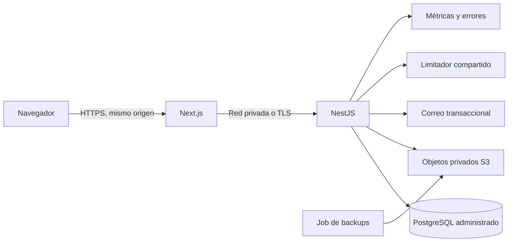

# Despliegue — evaluación y procedimiento propuesto

Estado: **no desplegado; infraestructura no contratada**. La configuración reproducible todavía debe implementarse en 6.2. Este documento no es una instrucción para ejecutar cambios de producción sin autorización.

## Arquitectura objetivo

No exponer PostgreSQL ni endpoints de métricas a Internet. Separar staging/producción, cuentas y credenciales; ningún entorno de pruebas debe usar datos reales sin proceso de anonimización autorizado.

## Alternativas y costos verificables

Consulta: 27-10-2026. Importes en USD/mes, sin conversión a CLP, impuestos ni compromisos de contratación. Son componentes de referencia, **no un presupuesto total ni una configuración dimensionada**.

| Alternativa | Componentes referenciales | Base parcial calculada | Ventajas | Riesgos / extras |
|---|---|---|---|---|
| A. Render + almacenamiento S3 externo | Dos servicios de 512 MB a USD 7 cada uno; PostgreSQL de 256 MB desde USD 6; Spaces desde USD 5 | USD 25/mes de base | Menor operación de servicios y despliegue administrado | Memorias mínimas pueden ser insuficientes para Next/PDF; confirmar almacenamiento DB, backup/PITR, egreso, región, correo, soporte y workspace |
| B. DigitalOcean App Platform + Managed PostgreSQL + Spaces | Dos instancias `apps-s-1vcpu-1gb` a USD 12; PostgreSQL Standard 1 GiB a USD 15,15; Spaces USD 5 | USD 44,15/mes de base, más almacenamiento de DB y demás extras | Aplicación, DB y objetos bajo un proveedor; configuración declarativa posible | No incluye HA, réplicas ni monitorización externa; dimensionar DB, egreso, región, builds, SMTP y soporte |

Fuentes: [Render pricing](https://render.com/pricing?trk=public_profile__reactions-text), [planes de cómputo Render](https://render.com/docs/compute-plans), [App Platform](https://docs.digitalocean.com/products/app-platform/details/pricing/), [PostgreSQL administrado](https://www.digitalocean.com/pricing/managed-databases), [Spaces](https://www.digitalocean.com/pricing/spaces-object-storage). La tabla oficial de PostgreSQL de DigitalOcean muestra almacenamiento facturable a USD 0,215/GiB/mes en incrementos de 10 GiB; confirmar el detalle del configurador antes de presupuestar.

No usar planes gratuitos o bases de desarrollo como prueba de recuperabilidad productiva. Verificar SLA, regiones, DPA, retención, PITR y recuperación con la oferta elegida. Falta cotizar correo, observabilidad, dominio y soporte. Staging separado aumenta el costo y no está incluido en las bases anteriores.

## Release que debe implementarse

1. PR con lint, tipos, unitarias, integración, E2E críticos, SCA y revisión de migraciones.
2. Construir imágenes con dependencias congeladas, usuario no root, sin `.env`, tests, cachés ni archivos del desarrollador. Asignar commit/digest.
3. Aprobar el destino de staging y sus secretos. Aplicar migraciones aditivas como tarea única; no ejecutarlas simultáneamente en cada réplica.
4. Desplegar el artefacto, comprobar liveness/readiness, smoke y E2E en staging.
5. Confirmar restore reciente, compatibilidad de esquema y procedimiento de rollback.
6. Requerir aprobación manual del environment de producción y promover **el mismo digest**. No reconstruir código diferente para producción.
7. Verificar errores, latencia y negocio. Si falla, retirar tráfico y restaurar el artefacto anterior compatible. No revertir datos financieros ni ejecutar down migrations destructivas automáticamente.

Limitaciones actuales: API escucha solo en loopback; no hay Dockerfiles de aplicación, liveness/readiness separados, pipeline de promoción ni plataforma elegida. Todo lo anterior permanece pendiente de implementación y prueba.
